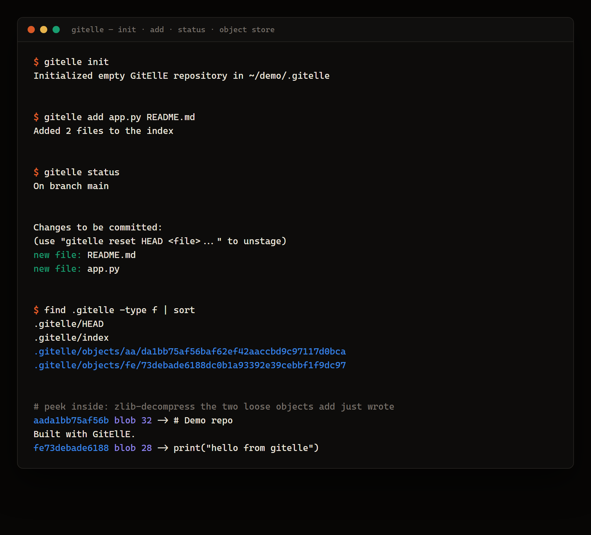
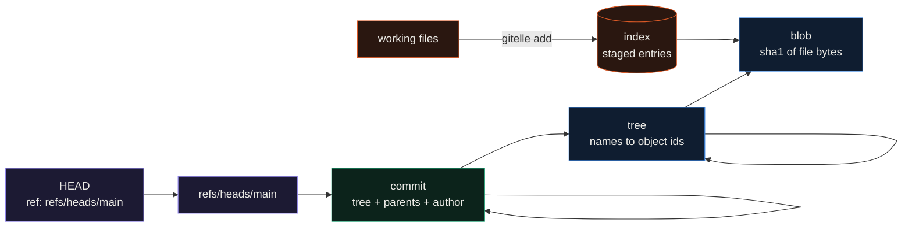

<div align="center">

# GitEllE

**An educational reimplementation of Git in Python: it builds the same content-addressed object store Git uses, so you can init a repo, stage files, and watch the blob objects appear on disk.**




</div>

This is an experiment and isn't finished: init, add, status and diff work, but commit can't build a tree from the index yet, so log, branch, reset and checkout don't work either (see Limitations).
I wrote GitEllE to understand Git by rebuilding its core: the object database, the index, and refs. It is not a Git replacement. The point is that the pieces are small and readable, and that the files it writes are the real thing, a SHA-1-named, zlib-compressed object store under `.gitelle/`, so you can open the objects and see how content addressing works. The run in the image is exactly that: after `add`, the two staged files exist as loose objects whose ids are the SHA-1 of `blob <size>\0<contents>`.

## How it works

GitEllE stores everything as objects keyed by the SHA-1 of a small header plus the content, written zlib-compressed to `.gitelle/objects/<first 2 hex>/<remaining 38>`, which is Git's loose-object layout. Three object types and a ref model sit on top:



A `blob` holds file bytes. A `tree` maps names to object ids (other trees or blobs). A `commit` points at one tree and its parent commits and carries author and message. `HEAD` is a symbolic ref holding `ref: refs/heads/main`, and a branch is a file under `.gitelle/refs/heads/` holding a commit id. `init` lays out `.gitelle/` with `objects/`, `refs/heads/`, `refs/tags/`, an `index`, and that `HEAD`.

## What a real run writes

The image is a live run. `init` creates `.gitelle/`, `add` hashes each file into a blob and records it in the index, and `status` reads the index back. Decompressing the two objects shows the Git object format exactly:

```text
$ gitelle init
Initialized empty GitEllE repository in ~/demo/.gitelle

$ gitelle add app.py README.md
Added 2 files to the index

$ gitelle status
On branch main

Changes to be committed:
  (use "gitelle reset HEAD <file>..." to unstage)
        new file:   README.md
        new file:   app.py

$ find .gitelle -type f | sort
.gitelle/HEAD
.gitelle/index
.gitelle/objects/aa/da1bb75af56baf62ef42aaccbd9c97117d0bca
.gitelle/objects/fe/73debade6188dc0b1a93392e39cebbf1f9dc97
```

Decompressing those two objects (`zlib.decompress`) gives `blob 32\0# Demo repo\nBuilt with GitEllE.\n` and `blob 28\0print("hello from gitelle")\n`, and `sha1` of each of those byte strings is the object's filename. `gitelle diff` prints a unified diff of the staged files against an empty tree.

## Quickstart

```bash
git clone https://github.com/EllE961/gitelle.git
cd gitelle
pip install -e .            # only dependency is click

gitelle init
echo 'print("hi")' > app.py
gitelle add app.py
gitelle status
gitelle diff
```

Run it on Linux, macOS or WSL. The index serializes stat fields (inode, device) into Git's 32-bit index format, and on a native Windows filesystem those values overflow that width, so staging there raises an error.

## Repository map

```text
src/gitelle/
  cli.py              click entry point, registers the ten commands
  core/objects.py     GitObject base + Blob, Tree, Commit: hashing, zlib read/write
  core/index.py       the staging index in Git's index v2 binary format
  core/refs.py        Reference, branches, tags, the HEAD symbolic ref
  core/repository.py  ties objects, index and refs together; init and lookups
  commands/           one module per command (init, add, status, diff, commit, ...)
  utils/              hashing, zlib compression, filesystem and diff helpers
tests/                pytest suite for objects, index, refs and the commands
```

## Limitations

- This is an alpha and a learning project. `init`, `add`, `status` and `diff` work end to end; `commit` is unfinished (the index-to-tree builder is not implemented), and the commands that need a commit to exist, `log`, `branch`, `reset` and `checkout`, do not work until that lands.
- Staging depends on POSIX stat fields fitting Git's 32-bit index layout, so run it on Linux, macOS or WSL rather than a native Windows filesystem.
- `clone` expects a reachable repository and is the least exercised path.
- It reads author identity from `GIT_AUTHOR_NAME` and `GIT_AUTHOR_EMAIL` rather than a config file.

## License

MIT. See [LICENSE](LICENSE).
